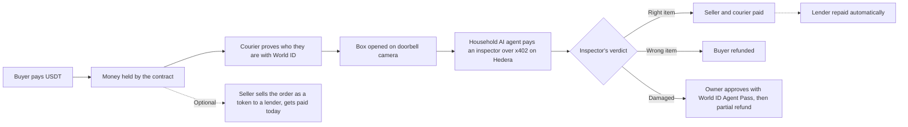

# OpenBox: pay on proof

**A checkout where the seller gets paid only when the right box arrives.**

Try it: **https://openbox-checkout.vercel.app**

---

## The problem

Online, buyers and sellers don't trust each other.

- Buyers fear paying and getting a soap bar instead of a phone.
- Sellers fear shipping and never getting paid, or getting a false "it was empty" claim.
- So people use cash on delivery. Couriers carry cash, refused parcels travel both ways, and sellers wait days for their money.

## The solution

The buyer pays upfront, but the money is **held** until the parcel is checked at the door.

1. The buyer pays in USDT, with no crypto knowledge needed.
2. A verified courier delivers the box.
3. The buyer opens it in front of the doorbell camera. An AI inspector checks it's the right item.
4. Right item: the seller and courier get paid. Wrong item: the buyer gets the money back. Damaged: a partial refund, approved by the buyer.

The seller can also **get paid today** by selling the unpaid order to a lender as a token.

---

## How it works



| Part | Chain or service | What it does |
|---|---|---|
| Payment, hold, payout, refunds | **Whitechain** | Official USDT, gasless for the buyer |
| Invoice token (get paid early) | **Whitechain** | `ReceivableNote`, an NFT that redirects the order's payout to the lender |
| Inspector payment | **Hedera** | The household AI agent finds and pays the inspector over **x402**, no human involved |
| Verdict log | **Hedera** | Every payment and verdict is written to a public HCS topic |
| Approval before the agent accepts a refund | **World ID Agent Pass** | The household owner approves on their phone |
| Courier check | **World ID** | Same person at pickup and at the door (simulated in the hosted demo) |

---

## Business opportunity

Example merchant, **assumptions** (not market data):

| | Per month |
|---|---|
| Orders | 10,000 |
| Average order | $40 |
| Sales (GMV) | **$400,000** |

What cash on delivery costs this merchant today, if 10% of parcels are refused and come back at $4 each way:

- Wasted shipping: 1,000 × $8 = **$8,000**
- Money stuck for 7 days on average: about **$93,000** at any time ($400,000 × 7 / 30)

What OpenBox earns:

- Checkout fee of 0.75% of sales: **$3,000 per merchant per month**
- Advances: if the merchant advances half its orders at a 2% discount, that's $200,000 × 2% = **$4,000 per month** shared between the lender and OpenBox
- Inspections: about $0.05 each, paid by the buyer's agent to independent inspectors

**100 merchants like this ≈ $300,000 per month in checkout fees alone.** The merchant still saves money, because the fee is lower than the refused-parcel waste.

### Same idea at enterprise scale

The doorbell is just one camera. The same "pay on proof" flow works anywhere goods change hands:

- **Factory receiving dock:** pay the supplier when the pallet's serials and count are checked on arrival.
- **Warehouse and 3PL:** release payment per inbound shipment, with no paperwork disputes.
- **Cross-border trade:** a buyer and seller in two countries, no letter of credit, settled in USDT the moment the cargo is verified.
- **Supplier finance:** the same invoice token lets a supplier get paid the day it ships, not 60 days later.

Example (**assumptions**): one manufacturer receiving 2,000 shipments a month at $25,000 each is **$50M a month**. A 0.1% fee is **$50,000 per month from one customer**, and paying suppliers on verified arrival instead of 60-day terms frees up their working capital.

---

## Try it

**Hosted demo** (free servers: the first click after a quiet period can take about a minute to wake up)

| What | Link |
|---|---|
| Landing page and all apps | https://openbox-checkout.vercel.app |
| Demo store (buy here first) | https://openbox-store.onrender.com |
| Presenter view (everything side by side) | https://openbox-checkout.vercel.app/demo |

1. Open the **demo store** and buy any product. You get free testnet USDT and pay no gas.
2. Use the **"Viewing as"** menu (top right) to switch between the **Merchant**, **Household**, **Courier** and **Lender** apps.
3. Merchant: pack the order and assign a courier. Courier: tap "Verify as Alice".
4. Open the **Doorbell** and show the parcel QR to the camera, or paste the code.
5. Watch the verdict and the money move. Every step links to the block explorer.

No World App? On a damaged order, use **"Simulate owner approval (demo)"**. It is labelled as simulated and settles without a World ID proof. The real World ID run is linked below.

**Run it locally**

```bash
pnpm install
git submodule update --init --recursive
cp .env.example .env
pnpm dev:local        # local chain + all services + web + store
```

Then open http://localhost:5174 (store) and http://localhost:3000 (apps).

**Add it to your store (SDK)**

The `openbox-checkout` SDK ([packages/sdk](packages/sdk)) adds a "Pay with OpenBox" button to any product page. The demo store's whole integration is [checkout.js](apps/demo-store/public/checkout.js):

```js
OpenBox.mount(card.querySelector(".checkout"), {
  publishableKey: "pk_demo_openbox", // safe in the browser
  sku: card.dataset.sku,             // price comes from your catalog
  wallet: "passkey",                 // no wallet popup, no gas for the buyer
  onPaid: ({ ref, explorerUrl }) => { /* mark the order paid */ },
});
```

Your server then gets signed webhooks (`X-OpenBox-Signature`) when an order is paid, dispatched, settled or refunded. It's available as a script tag or an npm module.

---

## Addresses and proof

**Whitechain Sepolia (chain 1874)**, all contracts verified on the explorer:

| Contract | Address |
|---|---|
| DeliveryCheckout | [0xdA0F23301e04fa82947b4d1c6d3E184838F35f51](https://explorer.testnet.whitechain.io/address/0xdA0F23301e04fa82947b4d1c6d3E184838F35f51) |
| ReceivableNote | [0x8Fe03452e96603653F00b79C36175A759633a479](https://explorer.testnet.whitechain.io/address/0x8Fe03452e96603653F00b79C36175A759633a479) |
| OpenBoxAccountFactory | [0xB0636a4424196218E5E0213b555882430365Fa8c](https://explorer.testnet.whitechain.io/address/0xB0636a4424196218E5E0213b555882430365Fa8c) |
| Official USDT (used for every payment) | [0xcedfB56113143d55b2358b8CFbB0dEB5Ad2f55a7](https://explorer.testnet.whitechain.io/address/0xcedfB56113143d55b2358b8CFbB0dEB5Ad2f55a7) |

**Hedera testnet**

| What | ID |
|---|---|
| Inspector directory topic | [0.0.11332143](https://hashscan.io/testnet/topic/0.0.11332143) |
| Payments and verdicts log topic | [0.0.11332145](https://hashscan.io/testnet/topic/0.0.11332145) |
| Payment token (HTS USDC) | 0.0.429274 |

**Live transactions**

| What happened | Transaction |
|---|---|
| Buyer pays in official USDT, gasless | [0x2555…53b9](https://explorer.testnet.whitechain.io/tx/0x25557217a1874af35f16f63c5c4fa9eeed79814850c6abea86049d46718853b9) |
| Right item: seller and courier paid in one call | [0x503e…7d32](https://explorer.testnet.whitechain.io/tx/0x503e1c629c4519837b13eee7179103614f00854d057339265251d8175e447d32) |
| Wrong item: buyer refunded | [0x56ef…9631](https://explorer.testnet.whitechain.io/tx/0x56efca68f23660652c4041f6da8e62ba572a5217f8ddeda1144d7e3a166f9631) |
| Damaged: partial refund after the owner's real World ID Agent Pass approval (Orb) | [0xaf2b…fcf6](https://explorer.testnet.whitechain.io/tx/0xaf2b29bf56d6f7c1ed00a3e93d5947f46368f906f336e9734f3f8d054ac4fcf6) |
| AI agent pays the inspector over x402 on Hedera (0.05 USDC) | [0.0.11332142@1793925153.308817963](https://hashscan.io/testnet/transaction/0.0.11332142%401793925153.308817963) |
| Seller gets paid early: lender buys the order as a token | [0xd33c…a02d](https://explorer.testnet.whitechain.io/tx/0xd33c5665eba2d52fc4959e3aad1f12f2bcf86b19b1b9fd21d030c4cef434a02d) |
| Delivery verified: lender repaid automatically | [0xb19c…4945](https://explorer.testnet.whitechain.io/tx/0xb19c1b74cf8edfcf020e8fcdd777453f1a41e4e31af00bdf49671b4ff84c4945) |

---

## How it works technically

**Checkout (Whitechain).** The store adds our SDK in about 15 lines (`OpenBox.mount`). The buyer's browser holds a hidden key and signs one EIP-3009 USDT authorization. Our relayer submits it and pays the gas, so the buyer never needs gas or a wallet popup. The relayer only accepts our own contract calls, with gas, rate and daily limits so it can't be drained.

**Holding and paying out (Whitechain).** `DeliveryCheckout` holds each order's USDT. It records dispatch (the courier's World ID hash), the handover at the door (a one-time signed QR), and then `settle`, which pays the seller, the courier or the buyer in one call based on the inspector's signed verdict. The contract checks the serial number rules itself and only accepts verdicts from allowlisted inspectors.

**AI inspection paid by an agent (Hedera x402).** Inspectors publish a signed listing (URL, price, key) to a Hedera HCS topic. The buyer's household agent reads the directory, applies its spending rules (budget, max price, allowlist), refuses inspectors that are too expensive, and pays the cheapest one per inspection using x402 with HTS USDC. The inspector checks the photo with a vision model, logs the verdict to HCS, and returns a signed verdict that is then submitted to Whitechain.

**Owner approval (World ID Agent Pass).** An AI agent shouldn't move money on its own. When a parcel is damaged, the agent pauses and asks the household owner to approve through World's login (`auth.world.org`). The backend checks World's signed ID token: signature, freshness, Orb or Selfie level, and that it's the same owner as before. Only then does it settle the refund.

**Get paid early (Whitechain).** The seller signs an offer. An allowlisted lender pays the seller now and receives a `ReceivableNote` NFT for that order. The checkout contract then sends that order's payout to the note holder. On delivery, the lender is repaid in the same `settle` call. Notes can only move between approved lenders, and a small seller bond covers wrong-item or damage losses.

**Stack.** Solidity + Foundry (60 tests), Node + Fastify backend, Next.js web apps, Hedera SDK (HCS, HTS), x402, World ID, vision model for inspection.

**Honest limits.** The Hedera verdict reaches Whitechain through our backend (anyone can verify the inspector's signature and the HCS record). The World ID approval is enforced by our backend, not the contract. In the hosted demo, the courier's World ID check is simulated.

---

## Repo

```
contracts/         DeliveryCheckout, ReceivableNote, smart account + tests
packages/sdk/      the store checkout widget
packages/hedera/   HCS directory and log
services/backend/  checkout, relayer, World ID, household agent, webhooks
services/inspector/  x402-paid AI inspection
apps/web/          merchant, household, courier and lender apps
apps/demo-store/   a sample store using the SDK
```

Team: **Aakash Kumar** ([@Aakash074](https://github.com/Aakash074)). See [AI_USAGE.md](AI_USAGE.md) for how AI tools were used.
